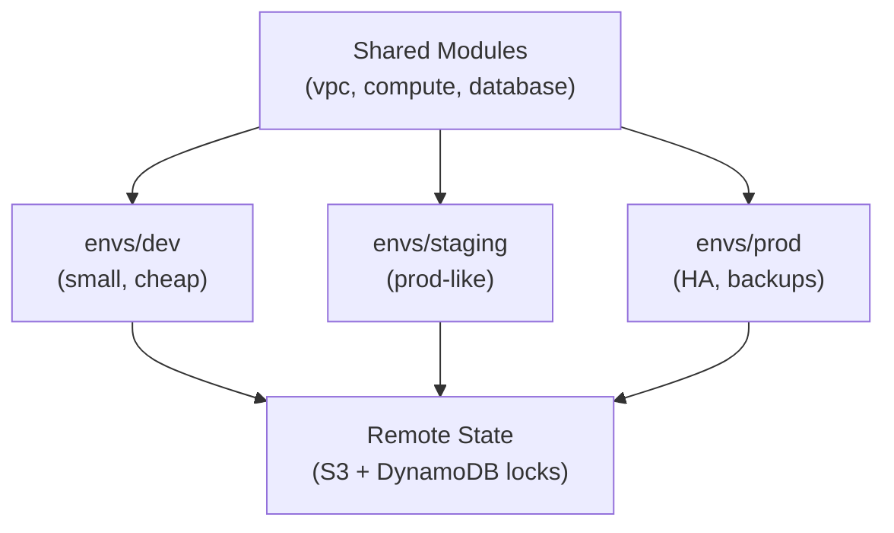
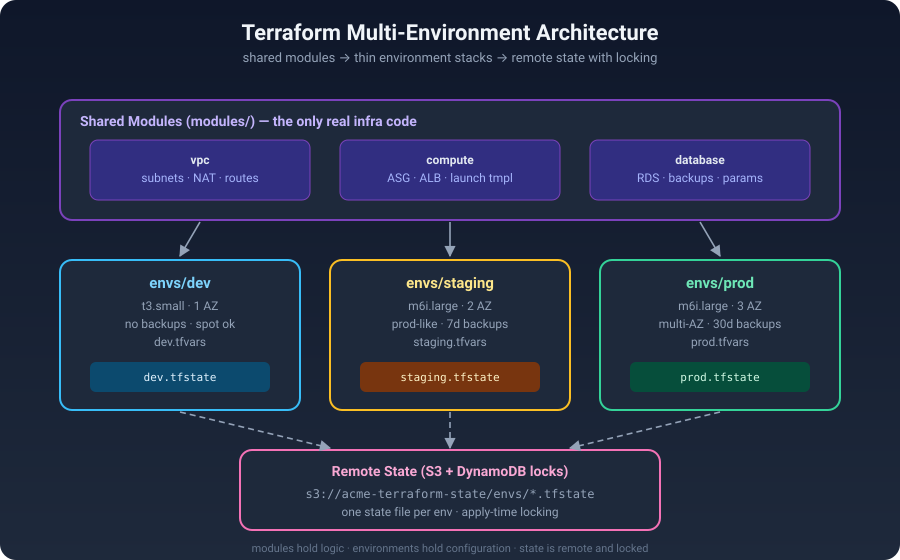

# Terraform Multi-Environment Guide


> One codebase. Three environments. Zero copy-paste.

## TL;DR

Running dev, staging, and prod on Terraform usually degenerates into copy-pasted directories that drift apart. The fix is a boring, reliable pattern: **shared modules** holding the real infrastructure code, plus **thin per-environment stacks** that only differ in variables — backed by **remote state with locking** so teams don't stomp on each other.



## The Problem With Copy-Paste Environments

Most teams start with `terraform apply` in one folder, then "duplicate for prod" — and six months later:

- **Drift** — prod got a security group rule that dev never saw; nobody knows which environment is "correct".
- **Copy-paste bugs** — a change made in `prod/` but forgotten in `staging/`.
- **State file chaos** — `terraform.tfstate` on someone's laptop, or worse, three people applying against the same local state.
- **No safe testing ground** — staging isn't prod-like, so prod is where you discover the bugs.

The pattern in this repo fixes all four: modules are written once and reused, each environment is just configuration, and state lives in S3 with DynamoDB locking.

## Architecture



How the pieces fit:

1. **Shared modules** (`modules/`) — the only place real infrastructure code lives: VPC, compute, database. Versioned, tested, boring.
2. **Environment stacks** (`envs/dev`, `envs/staging`, `envs/prod`) — thin wrappers that call the modules with different `*.tfvars`. Dev is small and cheap; prod is multi-AZ with backups.
3. **Remote state** — one S3 bucket, one state file per environment (`envs/dev.tfstate`, …), DynamoDB table for apply-time locking.
4. **CI/CD** — `terraform plan` on every PR (against the right environment's state), `apply` only from main after review.

## Pick Your Strategy: Workspaces vs Directories vs Modules

| | Terraform Workspaces | Directory per environment (no modules) | Shared modules + thin env stacks ✅ |
|---|---|---|---|
| Code reuse | Same code, `terraform.workspace` switches | Copy-paste between folders | Write once, call everywhere |
| Blast radius | One state file per workspace (easy to mix up) | Separate states | Separate states, clear boundaries |
| Drift risk | Medium (conditional logic creeps in) | High (folders diverge silently) | Low (differences live only in tfvars) |
| Tooling | Built-in (`terraform workspace`) | Just folders | Folders + module registry/versioning |
| Best for | Simple, identical environments | Never (don't do this) | Real teams, real prod |

Rule of thumb: workspaces are fine for ephemeral copies (PR previews, personal sandboxes). For **dev/staging/prod**, use shared modules with per-environment stacks.

## Quick Start: One Module, Three Environments

The whole pattern fits in one file. This is the shape of every environment stack:

```hcl
# envs/dev/main.tf (envs/staging and envs/prod look the same,
# only the tfvars change)

terraform {
  required_version = ">= 1.9.0"

  backend "s3" {
    bucket         = "acme-terraform-state"
    key            = "envs/dev.tfstate"   # staging/prod use their own key
    region         = "ap-southeast-1"
    dynamodb_table = "acme-terraform-locks"
    encrypt        = true
  }
}

module "network" {
  source = "../../modules/vpc"

  name               = "dev"
  cidr_block         = "10.1.0.0/16"
  availability_zones = 2
}

module "app" {
  source = "../../modules/compute"

  name          = "dev"
  subnet_ids    = module.network.private_subnet_ids
  instance_type = "t3.small"   # prod.tfvars says "m6i.large"
  min_capacity  = 1            # prod.tfvars says 3
  max_capacity  = 2            # prod.tfvars says 9
}
```

Plan and apply per environment — never from the wrong directory:

```bash
cd envs/staging
terraform init
terraform plan -var-file=staging.tfvars
terraform apply -var-file=staging.tfvars
```

The full working example is in [`main.tf`](main.tf) — it includes the backend, the sizing-per-environment maps, and the module calls with per-env overrides.

## Repository Layout

```
.
├── README.md            # this guide
├── architecture.svg     # modules → environments → remote state diagram
├── main.tf              # environment stack: backend, modules, per-env sizing
└── quiz.md              # test yourself: 5 questions
```

## Golden Rules of Multi-Environment Terraform

1. **Modules hold logic; environments hold configuration.** If you find an `if var.env == "prod"` inside a module, the abstraction leaked.
2. **One state file per environment.** A bad apply in dev must never be able to touch prod state.
3. **Lock your state.** S3 without DynamoDB locking is a race condition waiting for a Friday afternoon.
4. **Staging must be prod-like.** If staging is a t3.micro and prod is an auto-scaling fleet, staging tests nothing.
5. **Plan on PR, apply on merge.** `terraform plan` output belongs in the pull request; `apply` runs from CI on main, never from a laptop.

## 🧠 Quiz

Think you've got it? Head to [`quiz.md`](quiz.md) for 5 questions — from "why not workspaces for prod" to a real state-locking scenario.

---

Built as a daily cloud-engineering write-up. PRs welcome — reviewed, planned, then applied. 🤝
